# Per Diem take-home: multi-tenant storefronts

One Next.js app that runs many restaurants' ordering sites. Each restaurant has its own brand
(colors, fonts, layout, logo, favicon, SEO) and its own data (menu, prices, hours, currency,
timezone). **Which restaurant you see depends only on the address you visit**: a subdomain, a
custom domain, or a `/s/<slug>` path.

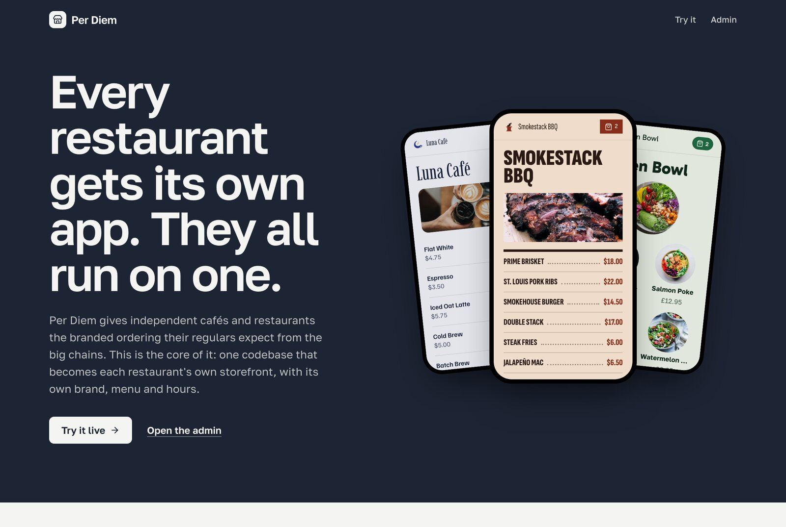

## Contents

- [Set up and run](#set-up-and-run)
- [Features](#features)
  - [The address picks the restaurant](#1-the-address-picks-the-restaurant)
  - [Three distinct brands from one codebase](#2-three-distinct-brands-from-one-codebase)
  - [Ordering on a phone](#3-ordering-on-a-phone)
  - [Hours, currency and units per store](#4-hours-currency-and-units-per-store)
  - [Admin dashboard](#5-admin-dashboard)
  - [Create a store from the admin](#6-create-a-store-from-the-admin)
  - [Real 404s that never leak another store](#7-real-404s-that-never-leak-another-store)
  - [Per-store SEO, logo and favicon](#8-per-store-seo-logo-and-favicon)
  - [Fresh data, cached reads](#9-fresh-data-cached-reads)
- [How it works](#how-it-works)
- [Quality: checks, tests and lint rules](#quality-checks-tests-and-lint-rules)
- [Assumptions](#assumptions)
- [Trade-offs](#trade-offs)
- [With more time](#with-more-time)

## Set up and run

### Requirements

- **Node.js 22.18 or newer** (Node 24 LTS recommended).
- **pnpm**: run `corepack enable` once and the version pinned in `package.json` is used
  automatically.
- **Docker** (optional), if you'd rather not install Node.

### Run locally

```bash
pnpm install
pnpm dev            # http://localhost:3000
```

There's no database to set up. On first start the app creates a SQLite file at `data/store.db`,
runs the migrations, and seeds three restaurants. `pnpm db:reset` deletes the file so the next
start reseeds from `src/db/seed/*.json`.

### Run with Docker

```bash
docker compose up --build   # http://localhost:3000
```

The image is a standalone Next.js server. The database lives in a named volume, so admin edits
survive restarts.

### Try these addresses

Chrome, Edge and Firefox send `*.localhost` to your own machine, so subdomains work without setup.

| Address                               | How it's matched      | What you get                       |
| ------------------------------------- | --------------------- | ---------------------------------- |
| http://localhost:3000                 | platform host         | Landing page                       |
| http://luna.localhost:3000            | subdomain             | Luna Café                          |
| http://smokestack.localhost:3000      | subdomain             | Smokestack BBQ                     |
| http://green-bowl.localhost:3000      | subdomain             | Green Bowl                         |
| http://localhost:3000/s/green-bowl    | path                  | Green Bowl                         |
| http://order.lunacafe.test:3000       | custom domain ¹       | Luna Café                          |
| http://nope.localhost:3000            | unknown subdomain     | "There's no store at this address" |
| http://luna.localhost:3000/not-a-page | known store, bad path | Luna-themed 404                    |
| http://localhost:3000/admin           | platform host         | Admin dashboard                    |
| http://localhost:3000/admin/new       | platform host         | Create a store                     |

¹ Add `127.0.0.1 order.lunacafe.test` to `/etc/hosts`, or run
`curl -H 'Host: order.lunacafe.test' localhost:3000`. The end-to-end tests map this domain inside
Chromium, so they don't need your hosts file.

### Scripts

| Command            | What it does                                                             |
| ------------------ | ------------------------------------------------------------------------ |
| `pnpm dev`         | Development server                                                       |
| `pnpm build`       | Production build                                                         |
| `pnpm start`       | Run the production build                                                 |
| `pnpm check`       | Generate route types, then format check, lint and type check (Vite+)     |
| `pnpm check:fix`   | Same, applying formatting and lint autofixes                             |
| `pnpm test`        | Unit tests (Vitest, through Vite+)                                       |
| `pnpm e2e`         | End-to-end tests (Playwright) against a production build with a fresh DB |
| `pnpm verify`      | All of the above, in order: the one command to run before shipping       |
| `pnpm db:reset`    | Delete the local database; the next start migrates and reseeds           |
| `pnpm db:generate` | Generate a Drizzle migration after changing `src/db/schema.ts`           |

The first time you run `pnpm e2e`, install the browser with `pnpm exec playwright install chromium`.

### Environment variables

All are optional.

| Variable        | Default         | Purpose                                                             |
| --------------- | --------------- | ------------------------------------------------------------------- |
| `ROOT_DOMAIN`   | `localhost`     | The platform's domain. `<slug>.ROOT_DOMAIN` is a store's subdomain. |
| `DATABASE_PATH` | `data/store.db` | SQLite file location (`/data/store.db` in Docker).                  |
| `PORT`          | `3000`          | Server port.                                                        |

### Add a store

Use **New store** in the admin (`/admin/new`): the store is live as soon as you create it. The three
demo stores come from `src/db/seed/*.json`, which is validated with Zod when the app starts, so a
typo there fails loudly with the path of the bad field.

## Features

### 1. The address picks the restaurant

Every request is matched to a store from its host and path before anything renders:

- **Subdomain:** `luna.localhost`
- **Custom domain:** `order.lunacafe.test`
- **Path:** `/s/luna`

The landing page lets you try this live. Pick an address and the same app answers as a different
restaurant, drawn with that store's real theme and dishes.

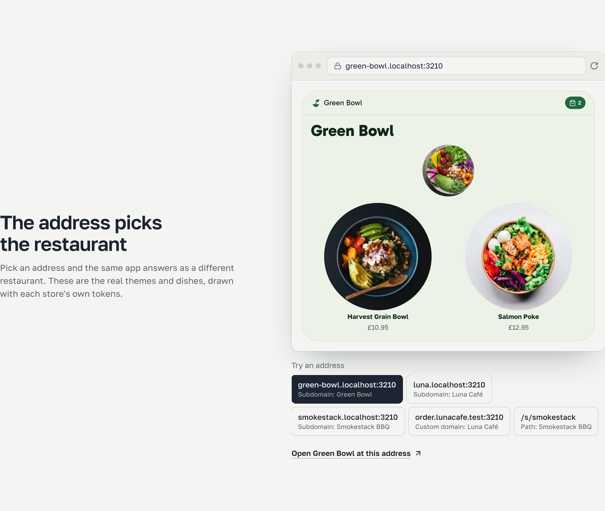

### 2. Three distinct brands from one codebase

Each brand comes from its own subject, so the three stores look like the work of three studios.
They differ in structure, not just color:

| Store          | Idea                         | Layout                                  | Type                              | Locale, currency, timezone |
| -------------- | ---------------------------- | --------------------------------------- | --------------------------------- | -------------------------- |
| Luna Café      | Moonlight: indigo and gold   | Rows: a photo beside each dish          | Imbue + Familjen Grotesk          | en-US, USD, New York       |
| Smokestack BBQ | Butcher paper and menu board | Board: dotted leaders, priced by weight | Sofia Sans Extra / Semi Condensed | en-US, USD, Chicago        |
| Green Bowl     | The bowl is round            | Gallery: round dish photos              | Gabarito + Golos Text             | en-GB, GBP, London         |

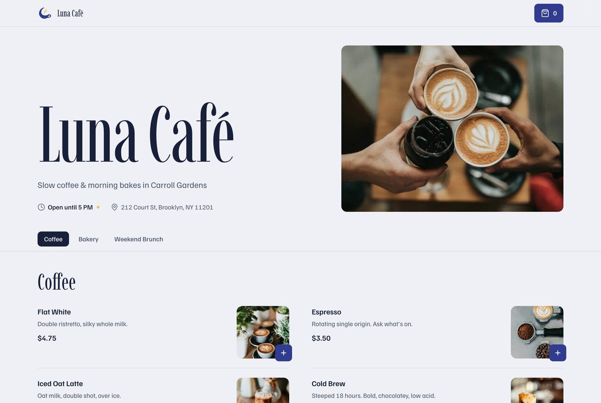
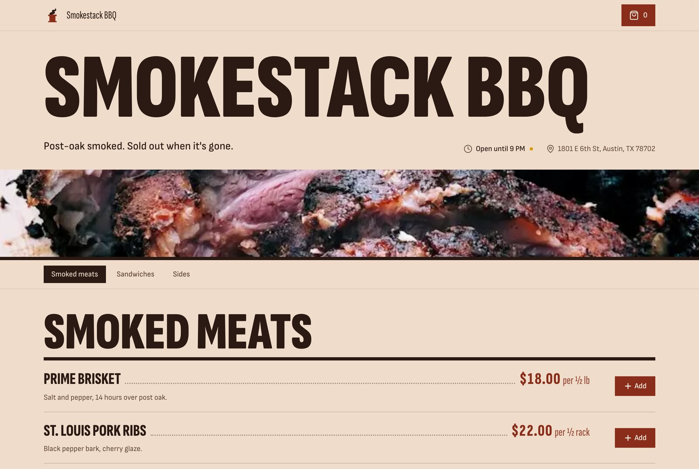
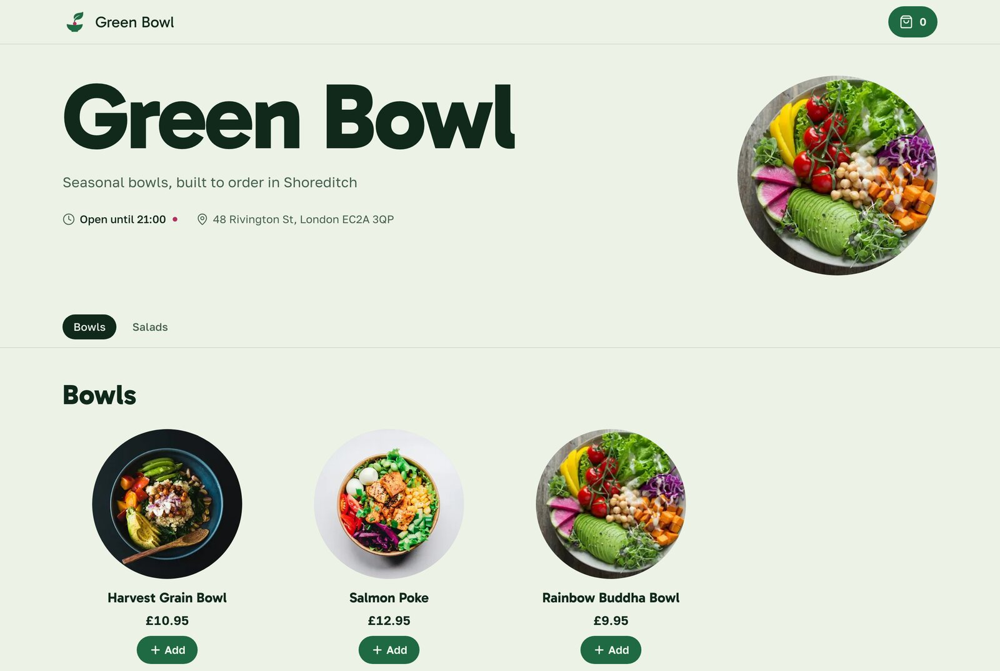

How it works:

- **One frame, three layouts.** The header, category nav, order bar, order sheet and footer are
  shared. A layout decides only the hero and how the menu is set.
- **Theme tokens.** A store's theme becomes CSS variables. Tailwind utilities such as `bg-primary`,
  `rounded-card` and `font-heading` read them, so components contain no store-specific styles.
- **Fonts.** They come from a curated set of lesser-known faces, because `next/font` resolves at
  build time. Faces aren't preloaded globally, so a page downloads only what its store uses.
- **Logos.** Generated for this project, in `public/logos`.

### 3. Ordering on a phone

The screens are built for ordering pickup on a phone, with the first Add button visible without
scrolling in every store.

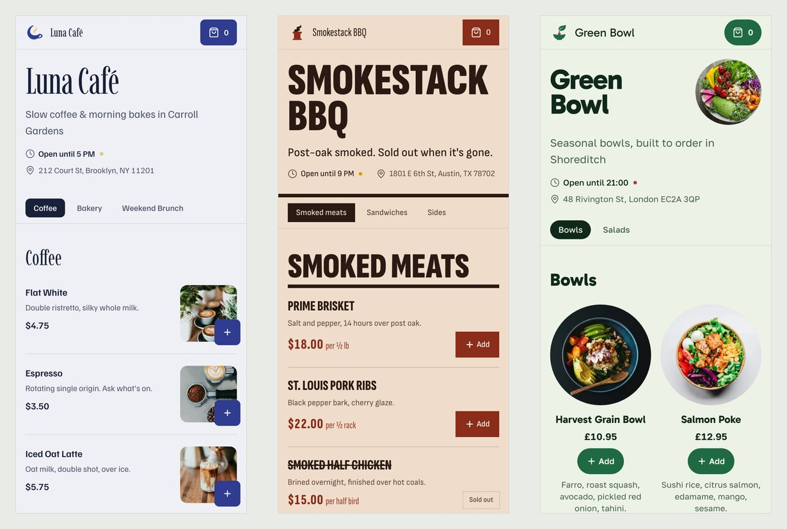

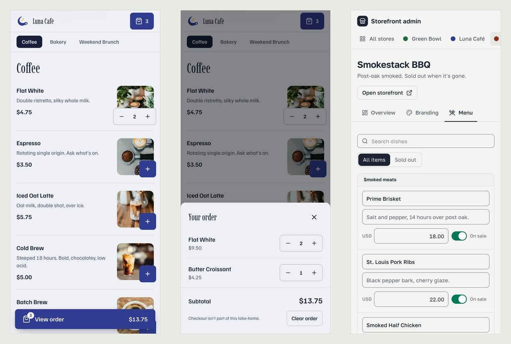

- **Dense menus.** Several dishes fit on one screen, and a scroll-aware category nav keeps your
  place.
- **Inline quantities.** "Add" becomes a − n + stepper. Touch targets are 44 px, and keyboard focus
  moves to the new stepper and back when you remove the item.
- **Order bar and sheet.**
  - Once you add something, a bar slides up showing the total.
  - It opens a bottom sheet on phones and a drawer on desktop.
  - The sheet is a native `<dialog>`, and its exit is faster than its entry.
- **Honest totals.** Prices carry their selling unit into the order ("2 × ½ lb"). An item that
  sells out after you add it is marked and offers Remove. Clearing the order can be undone.
- **Accessible feedback.** One live region announces each change ("Added Flat White. 1 in your
  order."). Every pressable element gives press feedback, and reduced motion keeps fades but
  drops movement.
- **Separate carts.** Each store keeps its own cart in `localStorage`, so carts never mix, even
  when stores share an origin in path mode.

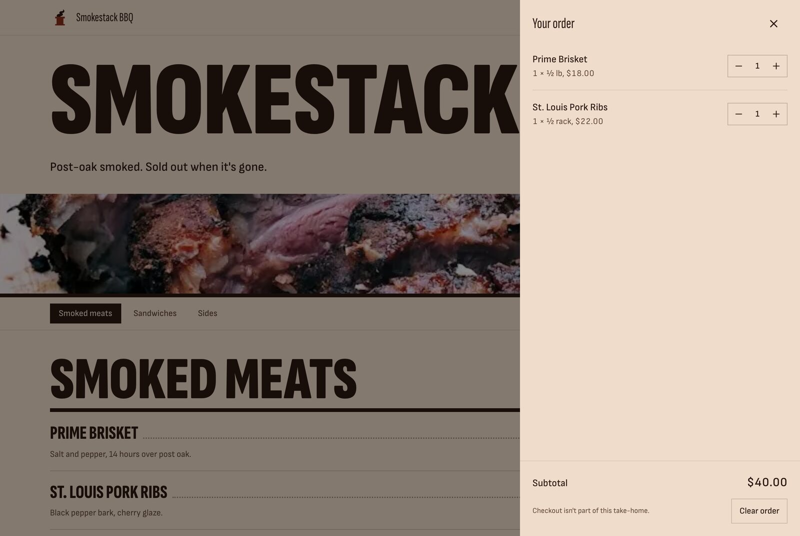

### 4. Hours, currency and units per store

- **Open status:** "Open until 5 PM", "Opens Wed at 11 AM". It's computed in the store's own
  timezone, handles shifts past midnight, and follows the locale's 12- or 24-hour clock.
- **Prices:** stored as integer cents, formatted with `Intl` in the store's currency and locale
  (`$18.00`, `£10.95`).
- **Units:** an item can have a selling unit, shown on the menu ("$18.00 per ½ lb") and in the
  order.

### 5. Admin dashboard

At `/admin` on the platform host. Its pages and API return 404 through a store's address.

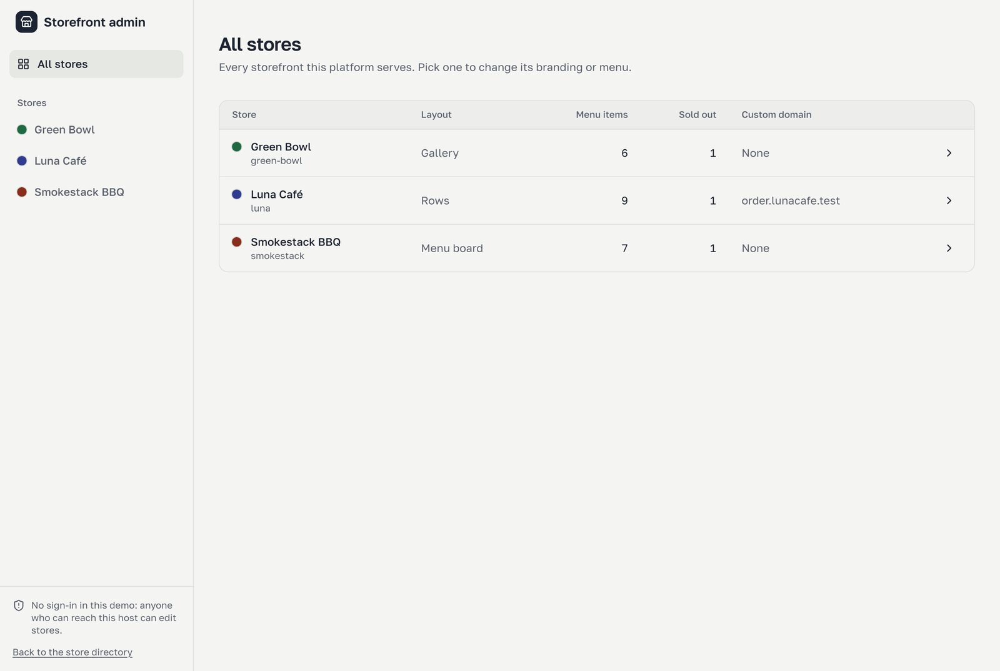

- **All stores:** a table of every storefront with its layout, item count, sold-out count and
  custom domain.
- **Overview:**
  - live open status in the store's timezone
  - menu and sold-out counts
  - a brand summary, opening hours and location

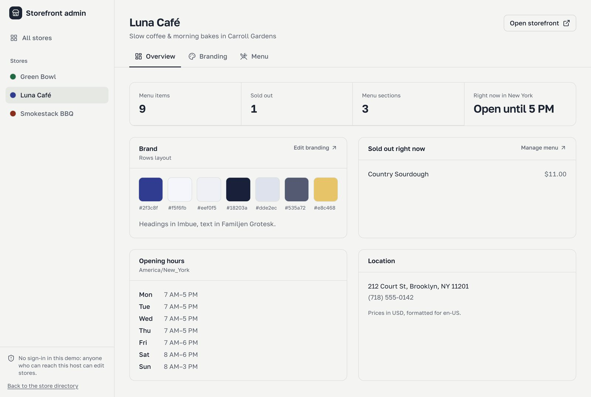

- **Branding:**
  - **Colors:** seven of them, with live WCAG contrast checks.
  - **Type:** heading and body fonts, with samples.
  - **Shape:** a layout picker and a corners control.
  - **Images:** logo and hero photo addresses, validated inline.
  - **Preview:** a sticky live preview renders the store's real dishes in the draft layout.
  - **Saving:** a save bar appears only when there are unsaved changes.

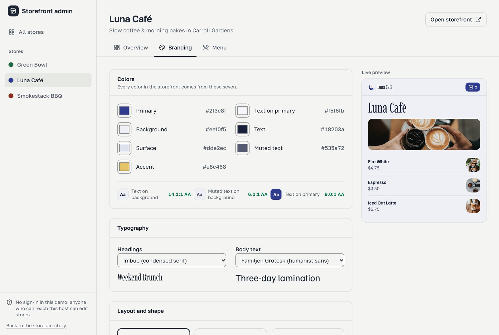

- **Menu:**
  - **Add a dish:** pick a section or type a new one
  - a searchable table with an All / Sold out filter
  - an availability switch that updates instantly and rolls back on error
  - inline edits to name, description and price
  - stacked cards instead of a table on phones

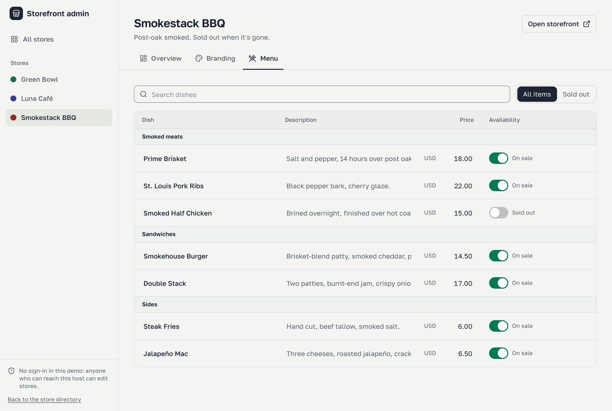

Admin reads always come from the database, not the storefront cache. Saves go through Server
Actions that validate their input with Zod and then refresh only that store's cached data.

### 6. Create a store from the admin

**New store** asks for the few things a store needs to go live:

- a name, and an address on the platform (suggested from the name)
- an optional custom domain and street address
- a starting look (one theme preset per layout, each passing WCAG AA, shown as live previews)
- a timezone, a currency and a number format

On **Create store** the new store is live at once at `<slug>.localhost:3000` and `/s/<slug>`. It
shows a "menu is on its way" state until its first dish is added, and the admin opens straight on
its menu editor. From there it's like any other store: add dishes, change the branding.

How it works:

- **Validation:** input is parsed with Zod. Addresses must be subdomain-safe, can't be ones the
  platform reserves (`www`, `admin`, `api`…), and must be unique. Custom domains must be real
  hostnames, unique, and outside the platform's own domain.
- **Uniqueness:** checked inside the creating transaction, with the database's unique indexes as a
  backstop.
- **Live immediately:** any cached "no such store" result for that address is cleared, so the
  store doesn't wait for a cache to expire.

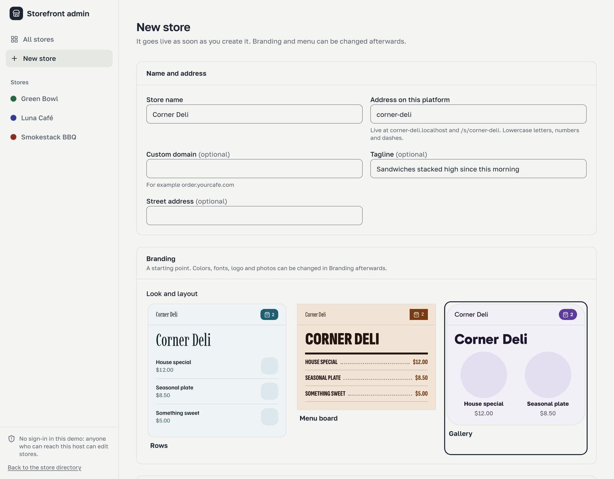

### 7. Real 404s that never leak another store

An address that matches no store returns **HTTP 404** with the platform's "There's no store at
this address" page. That covers an unknown subdomain, an unknown domain, and an unknown
`/s/<slug>`. Its link goes to the platform's own address, so it can't loop back to itself. A bad
path inside a known store gets that store's themed 404.

With streaming, the status code is fixed as soon as the response starts, so this check happens in
the proxy, before rendering: one indexed lookup by slug or hostname. Unknown addresses are
rewritten to a route that was prerendered as a 404.

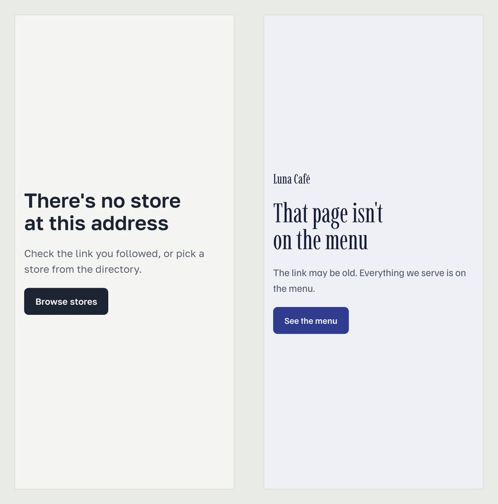

### 8. Per-store SEO, logo and favicon

Each store renders its own `<title>`, description, Open Graph tags and `theme-color`. Its logo
appears in the header and serves as its favicon. A store without a logo gets a generated SVG
favicon of its initial on its brand color.

### 9. Fresh data, cached reads

- **Cached reads.** Store and menu reads are `"use cache"` functions tagged
  `store:<slug>`, `menu:<slug>` and `stores`.
- **Targeted refresh.** An admin save calls `updateTag()` for exactly the store that changed. The
  very next storefront request shows the edit, and the HTML always contains the full menu (both
  checked in the e2e tests).
- **React Query.** The server dehydrates the menu into React Query, so the client starts with
  data. It refetches when the tab regains focus, which is how a sold-out change reaches a page
  someone already has open.

## How it works

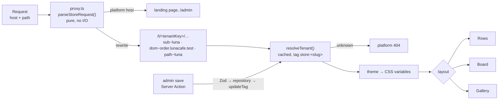

1. **Matching the store** ([`src/lib/tenant/parse.ts`](src/lib/tenant/parse.ts),
   [`src/proxy.ts`](src/proxy.ts)).
   - `parseStoreRequest` is a pure function: host and path in, one of
     `platform | subdomain | domain | path` out.
   - It normalizes case, ports, trailing dots and IPv6, and keeps reserved subdomains (`www`,
     `admin`, `api`) on the platform.
   - It never treats a look-alike such as `luna.notlocalhost` as a subdomain.
   - The proxy rewrites to an internal `/t/<tenantKey>` route and blocks direct access to `/t/*`.
     As Next's docs recommend, it does no database work.
2. **Data** ([`src/lib/repo`](src/lib/repo), [`src/db`](src/db)).
   - SQLite and Drizzle sit behind a `StoreRepository` interface.
   - Every method that touches a store's data takes that store's ID, and writes are scoped by
     item ID and store ID together, so a forged item ID from another store matches nothing.
     This is unit-tested.
   - Theme, hours and SEO are JSON columns, validated with Zod at the repository boundary.
3. **Rendering** ([`src/app/t/[tenantKey]`](src/app/t/[tenantKey]),
   [`src/components/storefront`](src/components/storefront)). The tenant layout resolves the store,
   applies its theme tokens, and renders the store's layout inside the shared frame.

```
src/
├── proxy.ts                    host/path → internal tenant route
├── app/
│   ├── (platform)/             landing page, admin dashboard, admin API, Server Actions
│   └── t/[tenantKey]/          storefront: layout, page, menu API, favicon, 404s
├── components/
│   ├── storefront/             shared frame, header, footer, heroes, open status
│   ├── menu/                   rows, board, gallery, category nav, quantity control
│   ├── cart/                   cart store, order bar and sheet, announcer
│   ├── admin/                  dashboard, branding editor, menu manager
│   ├── platform/               landing page sections, address demo, not-found
│   └── theme/                  StorePreview (shared by landing and admin)
├── lib/                        tenant parsing, repository, cached data, hours, money, theme
└── db/                         Drizzle schema, client (migrate + seed), seed JSON
lint/slop-plugin.ts             project-specific lint rules
tests/unit/  e2e/               Vitest and Playwright suites
```

## Quality: checks, tests and lint rules

`pnpm verify` runs everything. These numbers are from the last run:

- **Static checks:** formatting (Oxfmt), lint (Oxlint) and a full type check, run through Vite+.
- **53 unit tests** (Vitest):
  - host and path parsing edge cases, and tenant keys
  - new-store validation: reserved and malformed addresses, domains, timezones, currencies
  - timezone-aware open status, including overnight shifts and 12- and 24-hour locales
  - repository tenant isolation and validation; creating stores, conflicts, adding dishes
  - WCAG contrast of every seeded theme and every preset
  - image-address rules
  - the custom lint rules themselves
- **14 end-to-end tests** (Playwright, against a production build with a throwaway database):
  - each subdomain has its own name, data and brand color
  - per-store title, `theme-color` and favicon
  - the menu is in the server HTML
  - custom domain and path routing
  - unknown hosts, domains and paths return HTTP 404, and the not-found link
  - the themed store 404
  - carts stay separate on a shared origin
  - an admin edit is visible on the very next request
  - keyboard focus after Add
  - the branding form survives a half-typed URL
  - clearing an order can be undone
  - a store created in the admin is live at once, shows an empty menu, and takes a new dish
  - the new-store form rejects taken and reserved addresses

**Lint rules against sloppy code** ([`vite.config.ts`](vite.config.ts),
[`lint/slop-plugin.ts`](lint/slop-plugin.ts)):

- `slop/no-manual-memo`: the React Compiler (the Rust build, `turbopackRustReactCompiler`) is on,
  so `useMemo`, `useCallback` and `memo` are banned.
- `slop/no-fetch-in-effect`: server state goes through React Query.
- `slop/no-slop-comments`: rejects filler comments such as "in a real app…", "… rest of code",
  "placeholder" and "this function is used to…".
- `slop/no-hardcoded-color`: branding must come from theme tokens.
- **Plus:**
  - type-aware rules: no `any`, unsafe assertions, non-null assertions, `@ts-ignore` or floating
    promises
  - size and complexity limits: at most 80 lines per function, 250 per file, complexity 12 and
    3 parameters
  - no barrel files or import cycles
  - pages and components can't import the database layer directly
  - `noUncheckedIndexedAccess` in `tsconfig`

## Assumptions

- A store has one location (address, phone and weekly hours on the store).
- The subdomain is the store's slug. Custom domains are explicit records.
- Ordering stops at the order sheet. Checkout and payments are out of scope.
- The admin is an internal tool with **no authentication**. A note in its sidebar says so.
- New stores open every day 09:00–21:00 until real hours are set.
- Selling units, hours and phone come from a store's data. The admin shows them but doesn't edit
  them yet.

## Trade-offs

- **SQLite and a file on disk.** No setup and real SQL, but only one writer at a time, and stores
  are kept apart in application code rather than by database row-level security.
- **Render per request instead of prerendering each store.**
  - I first prerendered every store with `generateStaticParams`. In Next 16.4, after `updateTag`,
    the first request served a stale page, and the regenerated page arrived without the menu in
    its HTML. That's bad for freshness and for SEO, so I switched.
  - Pages now render per request on top of tag-cached data. That costs a render per view, but
    every request after an edit is fresh and the HTML is complete.
  - At scale I'd put a CDN in front, with a short `s-maxage` and `stale-while-revalidate` per host.
- **A database lookup in the proxy.** It costs one indexed query per storefront request. It's read
  live rather than cached, so a new store counts at once. Next recommends keeping the proxy light,
  and this is the smallest check that still lets an unknown store return a real 404 before
  streaming starts. At scale it would move to an edge key-value store that's updated whenever a
  store or domain changes.
- **A curated font list** instead of any Google Font, because `next/font` resolves at build time.
- **Theme as validated JSON** instead of a column per token. Easy to version and extend, at the
  cost of database-level constraints.

## With more time

- Sign-in for the admin with per-store roles (owners edit only their store), plus an audit log.
- DNS and TLS verification for custom domains, editing domains after creation, and a
  hostname-to-store map at the edge in place of the proxy's database lookup.
- Postgres with row-level security on the store ID, and image uploads instead of URLs.
- Editable hours, units and phone; deleting stores, sections and dishes; multiple locations per
  store; item options; real checkout; loyalty.
- Palette suggestions that always pass contrast, and more layouts.
- Visual regression snapshots for each store, and CI running `pnpm verify` on every pull request.
